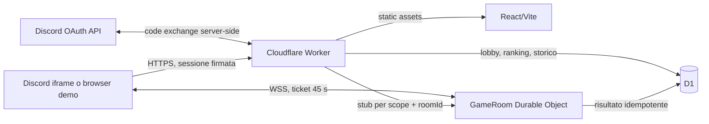

# Architettura

## Componenti e flusso

In produzione il Worker serve asset, `/api/*` e WebSocket sulla stessa origin. Questo evita endpoint assoluti incompatibili con il proxy/URL Mapping Discord. Il frontend usa sempre percorsi relativi `/api`.

## Confini di fiducia

- Il browser non è fidato: identità, ruolo, turno, mossa e risultato vengono ricavati o validati dal server.
- In demo il backend crea una sessione HMAC solo se `DEMO_MODE=true`; il config di deploy ha `false` per default.
- In Discord il Worker scambia il code OAuth, legge `/users/@me` e, se presente, verifica la guild con `/users/@me/guilds`. Il client secret resta un secret Worker.
- Un ticket WebSocket firmato, valido 45 secondi, evita di mettere il token di sessione a lunga durata nell'URL.
- `guildId`, `instanceId`, `roomId` e `matchId` restano entità distinte. Il nome del Durable Object contiene scope e room code.

## GameRoom

Ogni stanza ha un Durable Object SQLite-backed. Lo stato persistito contiene partecipanti, slot, ready, gioco, revisione, voti rivincita e gli ultimi 256 `commandId`. `acceptWebSocket` e gli handler `webSocketMessage`/`webSocketClose` consentono l'ibernazione. Le attachment dei socket conservano identità e finestra di rate-limit.

Ogni modifica accettata incrementa `revision`. Input duplicati o contemporaneamente in volo con lo stesso `commandId` non vengono riapplicati. Alla disconnessione lo slot resta riservato per 90 secondi; un alarm unico gestisce forfeit e cleanup dopo 24 ore senza tenere vivo l'oggetto con heartbeat.

## Engine

`GameDefinition<State, Move, PublicView, PrivateView>` espone `validateMove`, `applyMove`, `getViewForPlayer` e `getResult`. Tris e Connect sono immutabili. Il motore Connect riceve `width`, `height` e `connectN`; è quindi condiviso da Forza 3 e Forza 4. Il tipo `PrivateView` prepara l'estensione a carte, squadre e più giocatori senza introdurre quella complessità nell'MVP.

## D1

Tabelle:

- `users`: ID applicativo, nome mostrato, flag demo e timestamp; nessun token.
- `matches` e `match_players`: risultato finalizzato con `matchId` univoco.
- `rankings`: chiave composta `guild_id + game + user_id`, rating e contatori.
- `rooms`: indice leggero delle lobby per `scope_key`; lo stato autoritativo non è qui.

Indici coprono lobby per scope, ranking per guild+game+rating e storico per guild+data. La persistenza risultato inserisce prima il match con `INSERT OR IGNORE`: rating e statistiche cambiano soltanto se quel match era nuovo.

Regola MVP: rating iniziale 1000; vittoria +25; sconfitta −15 con minimo 0; pareggio invariato.
